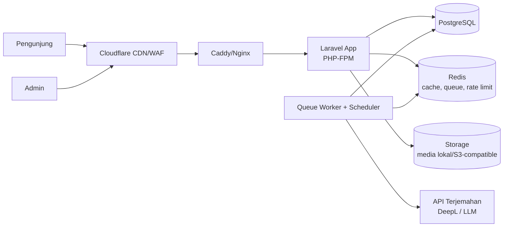
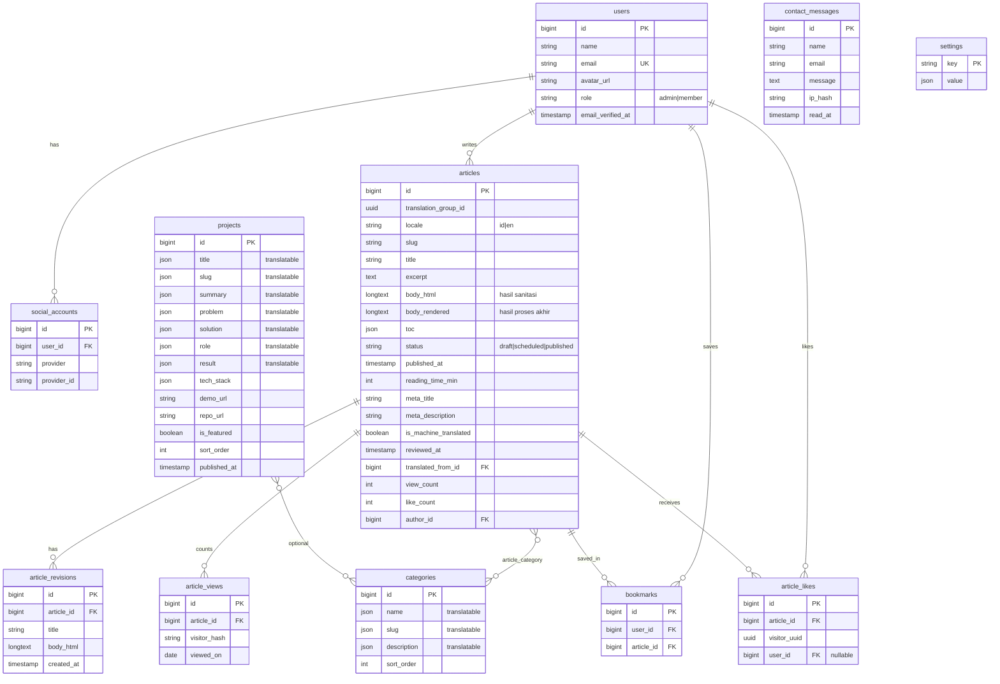
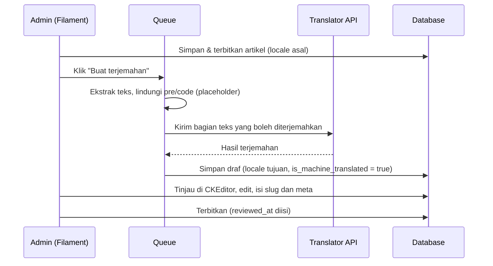
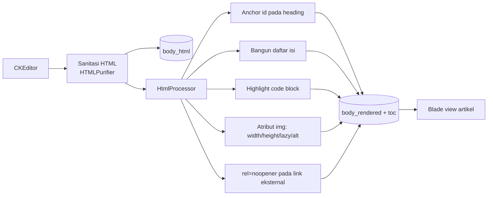

# Technical Design Document

| | |
|---|---|
| **Versi** | 0.1 (Draft) |
| **Tanggal** | 18 November 2026 |
| **Mengacu ke** | `01-project-brief.md` |
| **Status** | Menunggu review |

> Versi paket (Laravel, Livewire, Filament, PHP) dan kompatibilitas plugin pihak ketiga **harus diverifikasi saat inisialisasi proyek**, karena ekosistem berubah cepat.

---

## 1. Ringkasan arsitektur

Satu aplikasi Laravel (modular monolith) yang merender halaman publik di server (Blade + Livewire), menyediakan panel admin lewat Filament, dan menjalankan pekerjaan latar (terjemahan, penghitungan view) lewat queue.



Alasan memilih monolith: skala traffic kecil sampai menengah, satu penulis, dan SEO yang menuntut render di server. Memisah frontend dan backend hanya menambah beban operasional tanpa manfaat nyata.

## 2. Stack

| Lapisan | Pilihan | Catatan |
|---|---|---|
| Bahasa/Framework | PHP 8.5, Laravel 13 | Verifikasi versi saat init |
| UI publik | Blade, Livewire 4, Alpine.js, Tailwind CSS, `@tailwindcss/typography` | Render server, interaksi seperlunya |
| Admin | Filament 5 | Hanya peran `admin` |
| Editor | CKEditor 5 (self-hosted, `licenseKey: 'GPL'`) | Lihat bagian 8 |
| Database | PostgreSQL | MySQL/MariaDB sebagai alternatif jika hosting terbatas |
| Cache/Queue/Rate limit | Redis (awal: driver `database` atau `file` boleh) | |
| Auth | Laravel Socialite (Google, GitHub) | Fase 3 |
| i18n | Middleware locale + prefix URL, `spatie/laravel-translatable` untuk kategori dan proyek | |
| Media | `spatie/laravel-medialibrary` | Konversi WebP, thumbnail |
| SEO | `spatie/laravel-sitemap`, `spatie/laravel-feed` | |
| Sanitasi HTML | HTMLPurifier (mis. paket `mews/purifier`) | |
| Syntax highlight | Highlighter sisi server (mis. Phiki, atau Shiki via Node saat proses simpan) | Hasil disimpan, bukan dihitung tiap request |
| Testing | Pest, Larastan, Laravel Pint | |
| CI/CD | GitHub Actions, Lighthouse CI | |
| Container | Docker Compose | |
| Analytics | Umami atau Plausible (self-hosted) | Fase 2 |

## 3. Struktur kode (modular monolith)

Satu repo Laravel, kode bisnis dikelompokkan per domain.

```
app/
├── Domain/
│   ├── Blog/            # Article, Category, ArticleRevision, actions, queries
│   ├── Portfolio/       # Project, Setting profil, CV
│   ├── Engagement/      # Like, View, Bookmark, Visitor
│   ├── Localization/    # Locale resolver, TranslationGroup, Translator
│   ├── Identity/        # User, SocialAccount
│   └── Contact/         # ContactMessage
├── Http/
│   ├── Controllers/     # tipis, hanya koordinasi
│   └── Middleware/      # SetLocale, EnsureVisitorId, NoIndexAdmin
├── Livewire/            # LikeButton, LanguageSwitcher, LoginNudge, dst.
├── Filament/            # Resource admin
├── Jobs/                # TranslateArticleJob, RecordViewJob
└── Support/             # Helper, HtmlProcessor, Contracts
resources/
├── views/               # layouts, pages, components
├── js/                  # app.js (publik), admin.js (CKEditor, terpisah)
└── lang/                # id/, en/
docs/                    # dokumen proyek ini
tests/
```

Aturan: logika bisnis ada di class **Action** (`PublishArticle`, `CreateArticleTranslation`, `RecordArticleView`), bukan di controller atau komponen Livewire.

## 4. Model data

### 4.1 ERD



### 4.2 Kamus data dan constraint penting

| Tabel | Constraint/Index | Keterangan |
|---|---|---|
| `articles` | `UNIQUE (locale, slug)`, `INDEX (translation_group_id)`, `INDEX (status, published_at)` | Slug unik per bahasa. Satu grup terjemahan maksimal satu artikel per `locale` |
| `article_views` | `UNIQUE (article_id, visitor_hash, viewed_on)` | Satu view per pengunjung per hari. `view_count` di tabel artikel naik hanya jika insert berhasil |
| `article_likes` | `UNIQUE (article_id, visitor_uuid)` dan `UNIQUE (article_id, user_id)` (parsial untuk `user_id` non-null) | Mencegah like ganda |
| `bookmarks` | `UNIQUE (user_id, article_id)` | |
| `social_accounts` | `UNIQUE (provider, provider_id)` | |
| `settings` | Kunci: `profile.*`, `cv.id`, `cv.en`, `social.*`, `open_to_work` | Data profil yang jarang berubah |
| `contact_messages` | `ip_hash` bukan IP mentah | Sesuai NFR-05 |

Catatan:
- `body_html` menyimpan HTML dari CKEditor setelah disanitasi. `body_rendered` menyimpan hasil akhir (anchor heading, syntax highlight, atribut gambar, `rel` link) agar render artikel hanya berupa output string.
- `view_count` dan `like_count` adalah kolom denormalisasi agar tidak perlu `COUNT(*)` di setiap request.
- Tabel `article_views` bisa dipangkas berkala (mis. simpan 30 hari), dengan `view_count` tetap menjadi total permanen.

## 5. Internasionalisasi (i18n)

### 5.1 Penentuan bahasa

Urutan prioritas pada `SetLocale`:

1. Prefix URL (`/id/...` atau `/en/...`). Ini menang atas segalanya.
2. Cookie `locale` (pilihan manual pengguna).
3. Header `Accept-Language`.
4. Negara dari header Cloudflare `CF-IPCountry` (ID → `id`, lainnya → `en`) sebagai cadangan.
5. Default: `en`.

Aturan:
- Redirect dari `/` ke `/{locale}` hanya untuk pengunjung biasa. **Crawler tidak dipaksa redirect berdasarkan IP atau header.**
- Pilihan manual pengguna disimpan di cookie, berlaku 1 tahun.
- Halaman memuat `<link rel="alternate" hreflang="...">` untuk pasangan bahasa yang **sudah terbit**, ditambah `x-default`.

### 5.2 Konten dua bahasa

| Jenis konten | Strategi |
|---|---|
| String UI | File `lang/id` dan `lang/en` |
| Kategori, proyek, profil | Kolom JSON translatable (`spatie/laravel-translatable`) |
| Artikel | Satu baris per bahasa, dihubungkan oleh `translation_group_id` |

### 5.3 Alur terjemahan artikel



Aturan:
- Terjemahan selalu menjadi **draf**. Tidak bisa terbit otomatis.
- Isi `<pre>`, `<code>`, URL, dan nama variabel tidak diterjemahkan (diganti placeholder lalu dikembalikan).
- `Translator` adalah interface (`TranslatorInterface`) dengan implementasi DeepL atau LLM, sehingga penyedia mudah diganti.
- Halaman artikel menampilkan label kecil "Diterjemahkan dengan bantuan AI, ditinjau penulis" selama `is_machine_translated = true`.
- Jika artikel belum punya versi bahasa lain, pemilih bahasa mengarah ke daftar blog pada bahasa itu, bukan ke 404.
- Jika versi asal diubah setelah terjemahan dibuat, admin melihat penanda "terjemahan mungkin usang" (bandingkan `updated_at`).

## 6. View dan like anonim (tanpa fingerprinting)

### 6.1 Identitas pengunjung

- Middleware `EnsureVisitorId` memasang cookie first-party `vid` (UUID acak, `HttpOnly`, `SameSite=Lax`, `Secure`, masa berlaku 1 tahun) jika belum ada.
- Cookie ini hanya dipakai untuk **like** dan tidak untuk pelacakan lintas situs. Cantumkan di Kebijakan Privasi.

### 6.2 View counter

```
visitor_hash = HMAC_SHA256( IP + "|" + User-Agent + "|" + article_id,  key = daily_salt )
daily_salt   = HMAC_SHA256( tanggal_hari_ini (UTC), APP_KEY )
```

- Salt berganti tiap hari sehingga hash tidak dapat dipakai melacak pengunjung antar-hari.
- Alur: klien mengirim sinyal ringan (`POST /articles/{id}/view`) setelah scroll ≥ 25% **atau** waktu di halaman ≥ 15 detik. Server memfilter bot (User-Agent dan header), memeriksa rate limit, lalu menjalankan `RecordViewJob`.
- Job mencoba insert ke `article_views`. Jika berhasil (belum ada baris untuk hash dan tanggal itu), `view_count` bertambah.
- IP mentah tidak pernah disimpan.

### 6.3 Like

- `POST /articles/{id}/like` bersifat idempoten: `UNIQUE (article_id, visitor_uuid)`.
- Rate limit per IP dan per `vid`. Jika terjadi penyalahgunaan, tambahkan Cloudflare Turnstile.
- Saat pengguna login (Fase 3), like dengan `visitor_uuid` miliknya dikaitkan ke `user_id`, tanpa menggandakan hitungan.

### 6.4 Kompatibilitas dengan cache halaman

Halaman artikel di-cache penuh. Angka view dan like **dimuat terpisah** lewat fragmen kecil (komponen Livewire atau endpoint JSON) agar cache tidak tercemar data per pengunjung.

## 7. Autentikasi dan otorisasi (Fase 3)

- Login sosial (Google, GitHub) lewat Socialite. Tidak ada password.
- Peran: `admin` (satu orang) dan `member`. Panel Filament hanya terbuka untuk `admin`.
- Rute admin (`/admin`) diberi `noindex`, throttle login, dan dikecualikan dari sitemap. Pertimbangkan 2FA untuk akun admin.
- **Ajakan login:** banner inline di akhir artikel, tampil paling banyak sekali per sesi, dan hilang selamanya jika di-dismiss (disimpan di `localStorage`). Tidak ada modal yang menghalangi.
- Login hanya memberi nilai tambah (bookmark, riwayat baca). Tidak ada konten yang dikunci.

## 8. Editor CKEditor 5 dan pipeline konten

### 8.1 Integrasi

- Dipasang lewat plugin komunitas untuk Filament. **Verifikasi kompatibilitas dengan Filament 5 di sprint 1.** Cadangan: custom form field Filament dengan komponen Livewire dan Alpine yang membungkus CKEditor.
- Distribusi self-hosted (npm) dengan `licenseKey: 'GPL'`. Logo "Powered by CKEditor" muncul di area editor, tidak di halaman publik.
- Aset editor berada di entry Vite terpisah (`admin.js`) dan **hanya dimuat di route admin**.

### 8.2 Konfigurasi editor

| Aspek | Pengaturan |
|---|---|
| Heading | H2 sampai H4 saja (H1 dipegang judul artikel) |
| Plugin dasar | Bold, italic, link, daftar, kutipan, tabel, gambar, code block, media embed terbatas |
| Dimatikan | Warna dan ukuran font (menghasilkan `style` inline), font family |
| Upload gambar | Upload adapter ke endpoint admin, disimpan lewat Media Library, wajib mengisi teks alternatif |
| Code block | Daftar bahasa dibatasi (php, js, ts, bash, python, sql, yaml, dockerfile, dll.) |

### 8.3 Pipeline simpan dan render



- Sanitasi dijalankan **saat simpan**, dengan daftar tag dan atribut yang diizinkan secara eksplisit (allow-list).
- Proses akhir dijalankan **saat simpan**, bukan saat tiap request, dan hasilnya disimpan di `body_rendered`.
- Tampilan tipografi diatur CSS (`prose`), bukan style inline dari editor.
- Setiap simpan membuat baris di `article_revisions` (batasi jumlah revisi, mis. 20 terakhir).

## 9. SEO dan performa

| Area | Implementasi |
|---|---|
| Render | Server-side. Halaman publik hanya memuat JS minimal (Alpine, Livewire seperlunya) |
| Meta | `title`, `description`, canonical, Open Graph, Twitter Card per halaman dan bahasa |
| Struktur | Satu `<h1>` per halaman, heading berurutan, landmark HTML5 |
| Hreflang | Pasangan bahasa yang sudah terbit, plus `x-default` |
| Sitemap | Dihasilkan otomatis, memuat kedua bahasa dan memakai `lastmod` |
| Structured data | JSON-LD `Person` (`name`: M. Hafizh Rafid Hidayat, `alternateName`: Hafizh Rafid), `BlogPosting`, `BreadcrumbList` |
| Gambar | WebP, `srcset`, `width`/`height`, lazy loading kecuali gambar LCP |
| Font | Self-host, `font-display: swap`, subset |
| Cache | Response cache untuk halaman publik, cache header dan CDN lewat Cloudflare |
| Aset | Vite, minify, kompresi Brotli/gzip, cache jangka panjang untuk aset ber-hash |
| Pemantauan | Lighthouse CI di pipeline, Search Console, analytics tanpa cookie |

## 10. Keamanan

- Sanitasi HTML di sisi server (allow-list), CSP yang ketat (izinkan hanya sumber yang dipakai).
- Header: `X-Content-Type-Options`, `Referrer-Policy`, `Permissions-Policy`, HSTS.
- Rate limiting: formulir kontak, like, view, login, endpoint terjemahan.
- Formulir kontak: honeypot + rate limit, Turnstile bila perlu.
- Validasi upload: tipe MIME dan ukuran dibatasi, nama file dibuat ulang.
- Secret hanya di `.env` dan secret manager CI. Aktifkan GitHub secret scanning, Dependabot, dan `composer audit` di CI.
- Backup: `pg_dump` harian ke penyimpanan terpisah (S3-compatible atau server lain), retensi minimal 14 hari, uji pemulihan berkala.
- Log: jangan mencatat data pribadi atau token.

## 11. Deployment dan CI/CD

### 11.1 Infrastruktur

```
Cloudflare (DNS, CDN, WAF)
   └─ VPS
       └─ Docker Compose
           ├─ app        (php-fpm)
           ├─ web        (Caddy atau Nginx)
           ├─ postgres
           ├─ redis
           ├─ worker     (queue:work)
           └─ scheduler  (schedule:work atau cron)
```

### 11.2 Pipeline GitHub Actions

| Workflow | Pemicu | Langkah |
|---|---|---|
| `ci.yml` | Pull request dan push | Install dependensi, `pint --test`, Larastan, `pest`, build Vite, `composer audit` |
| `lighthouse.yml` | Pull request ke `main` | Lighthouse CI pada beranda, daftar blog, artikel contoh, dengan batas skor minimum |
| `deploy.yml` | Tag `v*` atau push ke `main` (setelah CI hijau) | Build image, deploy via SSH, `migrate --force`, `optimize`, restart worker |

Strategi branch: `main` selalu bisa dirilis, kerjakan fitur di branch pendek (`feat/...`) lalu PR. Gunakan Conventional Commits agar riwayat rapi.

## 12. Strategi pengujian

| Level | Cakupan prioritas |
|---|---|
| Unit | `HtmlProcessor` (anchor, TOC, highlight), pembuatan hash view, `Translator` placeholder |
| Feature | Penentuan locale, hreflang, like idempoten, view dihitung sekali per hari, sanitasi XSS, akses admin, publikasi artikel dan jadwal |
| Integrasi | `TranslateArticleJob` dengan penyedia palsu (fake), sitemap |
| Manual/otomatis | Lighthouse CI, pemeriksaan aksesibilitas (axe) pada halaman utama |

## 13. Catatan keputusan arsitektur (ADR ringkas)

| # | Keputusan | Alternatif yang ditolak | Alasan |
|---|---|---|---|
| ADR-01 | Modular monolith Laravel | Frontend dan backend terpisah | Kompleksitas tidak sebanding dengan skala |
| ADR-02 | Livewire + Blade | Inertia (Vue/React) | SEO, kesederhanaan, dan kecepatan pengerjaan |
| ADR-03 | PostgreSQL | MySQL, MongoDB | Full-text search, constraint parsial, kesiapan untuk SaaS |
| ADR-04 | Satu baris artikel per bahasa | Kolom JSON per bahasa | Slug, SEO, dan status terbit bisa berbeda per bahasa |
| ADR-05 | Hash harian + cookie UUID | Browser fingerprinting | Lebih akurat dan ramah privasi, risiko hukum lebih rendah |
| ADR-06 | CKEditor 5 (GPL) | TipTap, Markdown | Preferensi penulis. Evaluasi ulang untuk SaaS komersial |
| ADR-07 | Render dan sanitasi saat simpan | Render tiap request | Performa dan keamanan lebih mudah dijaga |
| ADR-08 | Terjemahan sebagai draf wajib tinjau | Terbit otomatis | Menjaga kualitas dan kredibilitas |

## 14. Pertanyaan teknis terbuka

1. Plugin CKEditor mana yang dipakai, dan apakah kompatibel dengan Filament 5 (spike di sprint 1)? pakai kahusoftware/filament-ckeditor-field, sangat nyaman dan kompatibel. untuk kedepannya kalau bisa ada fitur yang mewajibkan pengisian alt pada gambar.
2. DeepL atau LLM API untuk terjemahan, dan berapa batas biaya bulanan? 
3. Highlighter sisi server: PHP murni atau Shiki via Node?
4. VPS di penyedia mana, dan berapa spesifikasi minimal (RAM) agar PostgreSQL, Redis, dan PHP-FPM nyaman berjalan?
