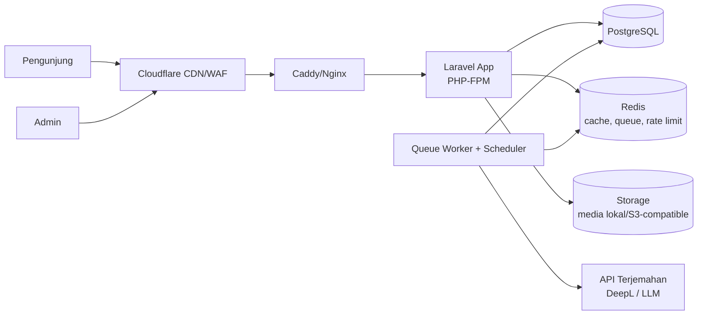
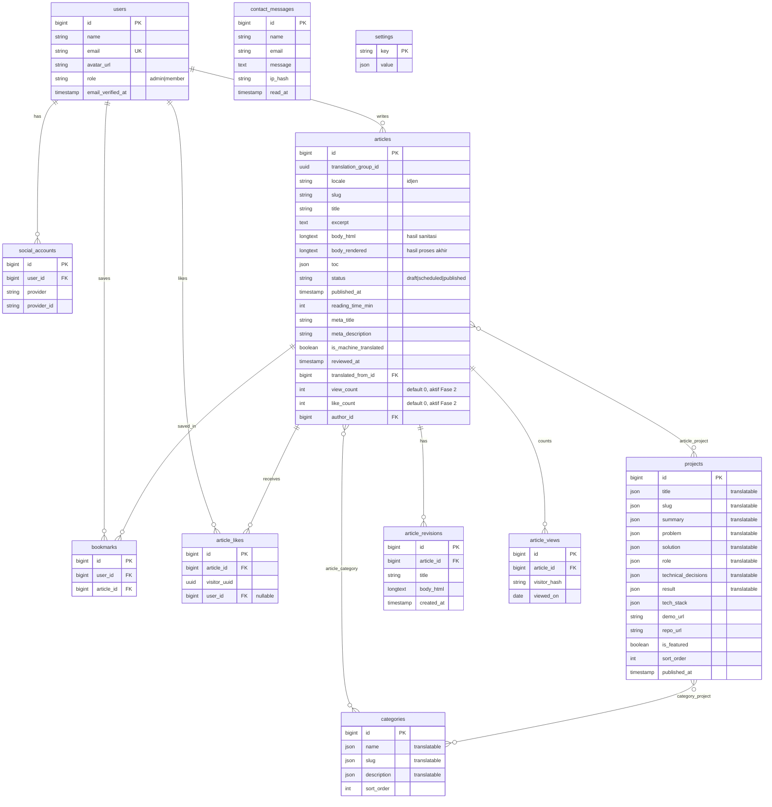
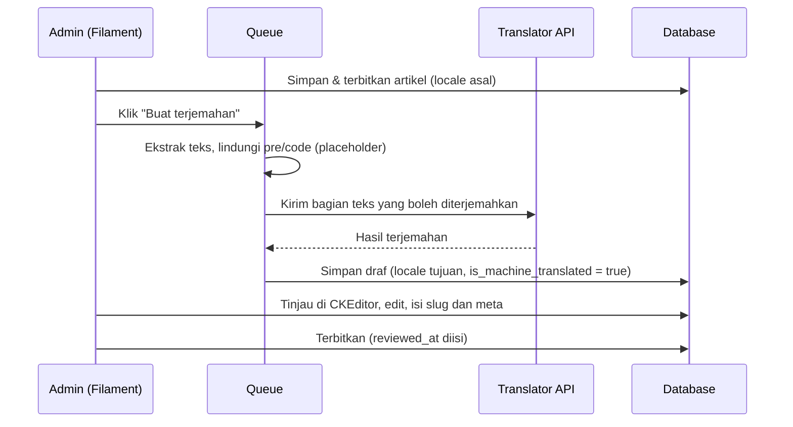
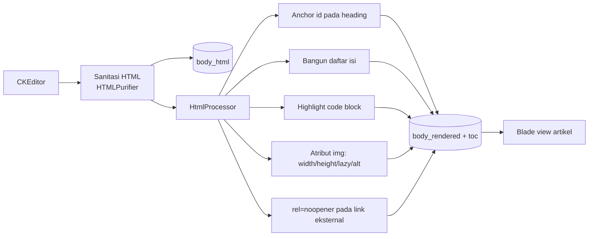

# Technical Design Document

| | |
|---|---|
| **Versi** | 0.2 |
| **Tanggal** | 23 November 2026 |
| **Mengacu ke** | `01-project-brief.md` (v0.2) |
| **Status** | Aktif (diperbarui pasca spike P0-06) |

> Versi paket (Laravel, Livewire, Filament, PHP) dan kompatibilitas plugin pihak ketiga **harus diverifikasi saat inisialisasi proyek**, karena ekosistem berubah cepat.

---

## 1. Ringkasan arsitektur

Satu aplikasi Laravel (modular monolith) yang merender halaman publik di server (Blade + Livewire), menyediakan panel admin lewat Filament, dan menjalankan pekerjaan latar (terjemahan, penghitungan view) lewat queue.



Alasan memilih monolith: skala traffic kecil sampai menengah, satu penulis, dan SEO yang menuntut render di server. Memisah frontend dan backend hanya menambah beban operasional tanpa manfaat nyata.

## 2. Stack

| Lapisan | Pilihan | Catatan |
|---|---|---|
| Bahasa/Framework | PHP 8.5, Laravel 13 | Verifikasi versi saat init |
| UI publik | Blade, Livewire 4, Alpine.js, Tailwind CSS, `@tailwindcss/typography` | Render server, interaksi seperlunya |
| Admin | Filament 5 | Hanya peran `admin` |
| Editor | CKEditor 5 (self-hosted, `licenseKey: 'GPL'`) via `kahusoftware/filament-ckeditor-field` | Terkonfirmasi di spike P0-06 (lihat §8) |
| Database | PostgreSQL | MySQL/MariaDB sebagai alternatif jika hosting terbatas |
| Cache/Queue/Rate limit | Redis (awal: driver `database` atau `file` boleh) | |
| Auth | Laravel Socialite (Google, GitHub) | Fase 3 |
| i18n | Middleware locale + prefix URL, `spatie/laravel-translatable` untuk kategori dan proyek | |
| Media | `spatie/laravel-medialibrary` | Konversi WebP, thumbnail (lihat §4.4) |
| SEO | `spatie/laravel-sitemap`, `spatie/laravel-feed` | Feed di Fase 2 |
| Sanitasi HTML | HTMLPurifier (mis. paket `mews/purifier`) | |
| Syntax highlight | Highlighter sisi server (PHP murni atau Shiki via Node saat proses simpan) | Diputuskan di spike P0-08 |
| Testing | Pest, Larastan, Laravel Pint | |
| CI/CD | GitHub Actions, Lighthouse CI | |
| Container | Docker Compose | |
| Analytics | Umami atau Plausible (self-hosted) | Fase 2 |

## 3. Struktur kode (modular monolith)

Satu repo Laravel, kode bisnis dikelompokkan per domain.

```
app/
├── Domain/
│   ├── Blog/            # Article, Category, ArticleRevision, actions, queries
│   ├── Portfolio/       # Project, Setting profil, CV
│   ├── Engagement/      # Like, View, Bookmark, Visitor (Fase 2 & 3)
│   ├── Localization/    # Locale resolver, TranslationGroup, Translator
│   ├── Identity/        # User, SocialAccount (Fase 3)
│   └── Contact/         # ContactMessage
├── Http/
│   ├── Controllers/     # tipis, hanya koordinasi
│   └── Middleware/      # SetLocale, EnsureVisitorId, NoIndexAdmin
├── Livewire/            # LikeButton, LanguageSwitcher, LoginNudge, dst.
├── Filament/            # Resource admin & halaman Settings
├── Jobs/                # TranslateArticleJob, RecordViewJob
└── Support/             # Helper, HtmlProcessor, Contracts
resources/
├── views/               # layouts, pages, components
├── js/                  # app.js (publik), admin.js (CKEditor, terpisah)
└── lang/                # id/, en/
docs/                    # dokumen proyek ini (01 sampai 06)
tests/
```

Aturan: logika bisnis ada di class **Action** (`PublishArticle`, `CreateArticleTranslation`, `RecordArticleView`), bukan di controller atau komponen Livewire.

## 4. Model data

### 4.1 ERD



### 4.2 Kamus data, fase migrasi, dan constraint penting

| Tabel | Fase migrasi | Constraint/Index | Keterangan |
|---|---|---|---|
| `users` | Fase 1 (`F1-10`) | `UNIQUE (email)` | Kolom `role`: `admin` atau `member` |
| `categories` | Fase 1 (`F1-10`) | `INDEX (sort_order)` | Kolom `name`, `slug`, `description` translatable (JSON) |
| `articles` | Fase 1 (`F1-10`) | `UNIQUE (locale, slug)`, `UNIQUE (translation_group_id, locale)`, `INDEX (status, published_at)` | Slug unik per bahasa. Maksimal satu artikel per `locale` dalam satu grup terjemahan. `view_count` & `like_count` dibuat dengan default `0` dan baru diisi/ditampilkan di Fase 2 |
| `article_category` | Fase 1 (`F1-10`) | `PRIMARY KEY (article_id, category_id)` | Pivot many-to-many artikel dan kategori |
| `article_revisions` | Fase 1 (`F1-10`) | `INDEX (article_id, created_at)` | Riwayat suntingan artikel (maks. 20 terakhir per artikel) |
| `projects` | Fase 1 (`F1-10`) | `INDEX (is_featured, sort_order)`, `INDEX (published_at)` | Termasuk `technical_decisions` untuk bagian "Keputusan teknis & tantangan" di studi kasus |
| `category_project` | Fase 1 (`F1-10`) | `PRIMARY KEY (category_id, project_id)` | Pivot kategori proyek untuk filter di halaman Portofolio |
| `article_project` | Fase 1 (`F1-10`) | `PRIMARY KEY (article_id, project_id)` | Pivot artikel terkait yang ditampilkan di halaman Detail Proyek |
| `contact_messages` | Fase 1 (`F1-10`) | `INDEX (read_at, created_at)` | `ip_hash` bukan IP mentah, sesuai NFR-05 |
| `settings` | Fase 1 (`F1-10`) | `PRIMARY KEY (key)` | Data profil, skills, timeline, tautan sosial, status open to work (lihat §4.3) |
| `article_views` | Fase 2 (`F2-02`) | `UNIQUE (article_id, visitor_hash, viewed_on)` | Satu view per pengunjung per hari. `view_count` naik hanya jika insert berhasil |
| `article_likes` | Fase 2 (`F2-04`) | `UNIQUE (article_id, visitor_uuid)` dan `UNIQUE (article_id, user_id)` (parsial untuk `user_id IS NOT NULL`) | Mencegah like ganda |
| `social_accounts` | Fase 3 (`F3-01`) | `UNIQUE (provider, provider_id)` | Relasi akun OAuth Google/GitHub |
| `bookmarks` | Fase 3 (`F3-03`) | `UNIQUE (user_id, article_id)` | Artikel tersimpan untuk pengguna login |

Catatan:
- `body_html` menyimpan HTML dari CKEditor setelah disanitasi. `body_rendered` menyimpan hasil akhir (anchor heading, syntax highlight, atribut gambar, `rel` link) agar render artikel hanya berupa output string.
- `view_count` dan `like_count` adalah kolom denormalisasi agar tidak perlu `COUNT(*)` di setiap request.
- Tabel `article_views` bisa dipangkas berkala (mis. simpan 30 hari), dengan `view_count` tetap menjadi total permanen.

### 4.3 Kontrak struktur JSON tabel `settings`

Agar tidak terjadi ketidaksesuaian struktur antara panel admin (`F1-18`) dan tampilan Portofolio (`F1-41`), kunci dan format nilai pada tabel `settings` dibakukan sebagai berikut:

| Key | Format `value` (JSON) | Keterangan |
|---|---|---|
| `profile.about` | `{"id": "...", "en": "..."}` | Teks perkenalan singkat pada halaman Portofolio |
| `profile.hero_subtitle` | `{"id": "...", "en": "..."}` | Kalimat pengantar di hero Beranda |
| `profile.open_to_work` | `true` atau `false` | Menampilkan/menyembunyikan badge "Open to work" di Beranda |
| `profile.skills` | `[{"group": {"id": "Backend", "en": "Backend"}, "items": ["Laravel", "PHP", "PostgreSQL"]}]` | Daftar kategori keahlian, dikelola via Filament Repeater |
| `profile.timeline` | `[{"period": "2023–kini", "type": "education", "title": {"id": "S1 Teknik Informatika", "en": "B.Sc. in Informatics"}, "organization": "Nama Kampus", "description": {"id": "...", "en": "..."}}]` | Timeline pendidikan, pengalaman, dan pencapaian (`type`: `education`, `experience`, `achievement`) |
| `social.links` | `{"github": "https://...", "linkedin": "https://...", "email": "mailto:..."}` | Tautan sosial di header/footer dan halaman Portofolio |
| `cv.paths` | `{"id": "cv/hafizh-rafid-id.pdf", "en": "cv/hafizh-rafid-en.pdf"}` | Path file PDF CV (atau gunakan Media Library sesuai §4.4) |

### 4.4 Standar Media Library Collections (`spatie/laravel-medialibrary`)

Gunakan nama koleksi standar berikut di seluruh aplikasi agar upload, konversi WebP, dan pemanggilan view tetap konsisten:

| Model / Entitas | Nama Collection | Tipe | Ketentuan |
|---|---|---|---|
| `Article` | `cover` | `singleFile` | Gambar sampul 16:9 (1200×675), konversi WebP & thumbnail |
| `Article` | `content_images` | multiple | Gambar yang diunggah lewat CKEditor di dalam isi artikel |
| `Project` | `thumbnail` | `singleFile` | Tangkapan layar utama proyek (rasio 16:9), konversi WebP |
| `Project` | `gallery` | multiple | Tangkapan layar tambahan untuk bagian galeri studi kasus |
| `SiteMedia` / `User` (admin) | `avatar` | `singleFile` | Foto profil di hero Beranda dan Portofolio |
| `SiteMedia` / `Setting` | `cv_id`, `cv_en` | `singleFile` | Alternatif penyimpanan CV PDF per bahasa (MIME dibatasi `application/pdf`) |

## 5. Internasionalisasi (i18n)

### 5.1 Penentuan bahasa dan batas Route Group

Urutan prioritas pada middleware `SetLocale`:

1. Prefix URL (`/id/...` atau `/en/...`). Ini menang atas segalanya.
2. Cookie `locale` (pilihan manual pengguna).
3. Header `Accept-Language`.
4. Negara dari header Cloudflare `CF-IPCountry` (ID → `id`, lainnya → `en`) sebagai cadangan. *(Pada development lokal dan automated test, header ini cukup di-mock di request test).*
5. Default: `en`.

Aturan routing dan isolasi:

| Kelompok Route | Pola URL | Perlakuan Middleware `SetLocale` |
|---|---|---|
| **Halaman publik** | `/{locale}`, `/{locale}/portfolio`, `/{locale}/projects/{slug}`, `/{locale}/blog`, `/{locale}/blog/category/{slug}`, `/{locale}/blog/{slug}`, `/{locale}/privacy`, (Fase 2) `/{locale}/feed.xml`, (Fase 3) `/{locale}/login`, `/{locale}/bookmarks` | Wajib prefix `id` atau `en`. Locale aplikasi di-set dari segmen URL pertama. |
| **Root redirector** | `/` | Redirect 302 ke `/{locale}` untuk pengunjung biasa. **Crawler tidak dipaksa redirect berdasarkan IP atau header** (tampilkan versi default atau tautan eksplisit). |
| **Non-locale / sistem** | `/admin/*`, `/cv/{locale}`, `/sitemap.xml`, `/robots.txt`, serta endpoint interaksi Fase 2 (`POST /articles/{id}/view`, `POST /articles/{id}/like`) | **Tidak** memakai redirect `SetLocale`. `/admin/*` dipasangi `NoIndexAdmin`. |

Aturan tambahan:
- Pilihan manual pengguna disimpan di cookie `locale`, berlaku 1 tahun.
- Halaman memuat `<link rel="alternate" hreflang="...">` untuk pasangan bahasa yang **sudah terbit**, ditambah `x-default`.
- Daftar blog pada `/{locale}/blog` **hanya menampilkan artikel dengan `locale` aktif** (tidak mencampur artikel lintas bahasa di halaman yang sama, lihat ADR-10).

### 5.2 Konten dua bahasa

| Jenis konten | Strategi |
|---|---|
| String UI | File `lang/id` dan `lang/en` |
| Kategori, proyek, profil (`settings`) | Kolom/struktur JSON translatable (`spatie/laravel-translatable` untuk model) |
| Artikel | Satu baris per bahasa, dihubungkan oleh `translation_group_id` |

### 5.3 Alur terjemahan artikel



Aturan:
- Terjemahan selalu menjadi **draf**. Tidak bisa terbit otomatis.
- Isi `<pre>`, `<code>`, URL, dan nama variabel tidak diterjemahkan (diganti placeholder lalu dikembalikan).
- `Translator` adalah interface (`TranslatorInterface`) dengan implementasi DeepL atau LLM (diputuskan di spike `P0-07`), sehingga penyedia mudah diganti.
- Halaman artikel menampilkan label kecil "Diterjemahkan dengan bantuan AI, ditinjau penulis" selama `is_machine_translated = true`.
- Jika artikel belum punya versi bahasa lain, pemilih bahasa mengarah ke daftar blog pada bahasa itu, bukan ke 404.
- Jika versi asal diubah setelah terjemahan dibuat, admin melihat penanda "terjemahan mungkin usang" (bandingkan `updated_at`).

## 6. View dan like anonim (Fase 2 — tanpa fingerprinting)

### 6.1 Identitas pengunjung

- Middleware `EnsureVisitorId` memasang cookie first-party `vid` (UUID acak, `HttpOnly`, `SameSite=Lax`, `Secure`, masa berlaku 1 tahun) jika belum ada.
- Cookie ini hanya dipakai untuk **like** dan tidak untuk pelacakan lintas situs. Cantumkan di Kebijakan Privasi.

### 6.2 View counter

```
visitor_hash = HMAC_SHA256( IP + "|" + User-Agent + "|" + article_id,  key = daily_salt )
daily_salt   = HMAC_SHA256( tanggal_hari_ini (UTC), APP_KEY )
```

- Salt berganti tiap hari sehingga hash tidak dapat dipakai melacak pengunjung antar-hari.
- Alur: klien mengirim sinyal ringan (`POST /articles/{id}/view`) setelah scroll ≥ 25% **atau** waktu di halaman ≥ 15 detik. Server memfilter bot (User-Agent dan header), memeriksa rate limit, lalu menjalankan `RecordViewJob`.
- Job mencoba insert ke `article_views`. Jika berhasil (belum ada baris untuk hash dan tanggal itu), `view_count` bertambah.
- IP mentah tidak pernah disimpan.

### 6.3 Like

- `POST /articles/{id}/like` bersifat idempoten: `UNIQUE (article_id, visitor_uuid)`.
- Rate limit per IP dan per `vid`. Jika terjadi penyalahgunaan, tambahkan Cloudflare Turnstile.
- Saat pengguna login (Fase 3), like dengan `visitor_uuid` miliknya dikaitkan ke `user_id`, tanpa menggandakan hitungan.

### 6.4 Kompatibilitas dengan cache halaman

Halaman artikel di-cache penuh. Angka view dan like **dimuat terpisah** lewat fragmen kecil (komponen Livewire atau endpoint JSON) agar cache tidak tercemar data per pengunjung.

## 7. Autentikasi dan otorisasi (Fase 3)

- Login sosial (Google, GitHub) lewat Socialite. Tidak ada password.
- Peran: `admin` (satu orang) dan `member`. Panel Filament hanya terbuka untuk `admin`.
- Rute admin (`/admin`) diberi `noindex`, throttle login, dan dikecualikan dari sitemap. Pertimbangkan 2FA untuk akun admin.
- **Ajakan login:** banner inline di akhir artikel, tampil paling banyak sekali per sesi, dan hilang selamanya jika di-dismiss (disimpan di `localStorage`). Tidak ada modal/pop-up yang menghalangi.
- Login hanya memberi nilai tambah (bookmark, riwayat baca). Tidak ada konten yang dikunci.

## 8. Editor CKEditor 5 dan pipeline konten

### 8.1 Integrasi

- Dipasang menggunakan **`kahusoftware/filament-ckeditor-field`** (terkonfirmasi kompatibel dengan Filament 5 pada spike `P0-06`). Cadangan jangka panjang: custom form field Filament dengan komponen Livewire + Alpine.
- Distribusi self-hosted (npm/vendor bundle) dengan `licenseKey: 'GPL'`. Logo "Powered by CKEditor" muncul di area editor, tidak di halaman publik.
- Aset editor berada di entry terpisah (`admin.js` / aset Filament) dan **hanya dimuat di route admin**.
- **Penegakan wajib `alt` pada gambar (2 lapis):**
  1. *Lapis Editor (UX):* Aktifkan tombol *Text Alternative* pada toolbar gambar CKEditor agar penulis mudah mengisi teks alternatif langsung setelah upload.
  2. *Lapis Server (Penegakan Wajib):* Pada Action `PublishArticle` (ketika status artikel diubah menjadi `published` atau `scheduled`), lakukan pemeriksaan DOM atas `body_html` untuk memastikan setiap tag `` memiliki atribut `alt` non-kosong. Publikasi ditolak dengan pesan validasi yang jelas jika masih ada gambar tanpa `alt`. Penyimpanan sebagai `draft` tetap diizinkan agar tidak mengganggu proses penulisan.

### 8.2 Konfigurasi editor

| Aspek | Pengaturan |
|---|---|
| Heading | H2 sampai H4 saja (H1 dipegang judul artikel) |
| Plugin dasar | Bold, italic, link, daftar, kutipan, tabel, gambar, code block, media embed terbatas |
| Dimatikan | Warna dan ukuran font (menghasilkan `style` inline), font family |
| Upload gambar | Upload adapter ke endpoint admin, disimpan lewat Media Library (`content_images`), wajib `alt` sebelum publikasi |
| Code block | Daftar bahasa dibatasi (`php`, `js`, `ts`, `bash`, `python`, `sql`, `yaml`, `dockerfile`, dll.) |

### 8.3 Pipeline simpan dan render



- Sanitasi dijalankan **saat simpan**, dengan daftar tag dan atribut yang diizinkan secara eksplisit (allow-list).
- Proses akhir dijalankan **saat simpan**, bukan saat tiap request, dan hasilnya disimpan di `body_rendered` bersama `toc` dan `reading_time_min`.
- Tampilan tipografi diatur CSS (`prose`), bukan style inline dari editor.
- Setiap simpan membuat baris di `article_revisions` (batasi jumlah revisi, mis. 20 terakhir).

## 9. SEO dan performa

| Area | Implementasi |
|---|---|
| Render | Server-side. Halaman publik hanya memuat JS minimal (Alpine, Livewire seperlunya) |
| Meta | `title`, `description`, canonical, Open Graph, Twitter Card per halaman dan bahasa |
| Struktur | Satu `<h1>` per halaman, heading berurutan, landmark HTML5 |
| Hreflang | Pasangan bahasa yang sudah terbit, plus `x-default` |
| Sitemap | Dihasilkan otomatis, memuat kedua bahasa dan memakai `lastmod` |
| Structured data | JSON-LD `Person` (`name`: M. Hafizh Rafid Hidayat, `alternateName`: Hafizh Rafid), `BlogPosting`, `BreadcrumbList` (MVP Fase 1) |
| Gambar | WebP, `srcset`, `width`/`height`, lazy loading kecuali gambar LCP |
| Font | Self-host, `font-display: swap`, subset |
| Cache | Response cache untuk halaman publik (Fase 2), cache header dan CDN lewat Cloudflare |
| Aset | Vite, minify, kompresi Brotli/gzip, cache jangka panjang untuk aset ber-hash |
| Pemantauan | Lighthouse CI di pipeline, Search Console, analytics tanpa cookie (Fase 2) |

## 10. Keamanan

- Sanitasi HTML di sisi server (allow-list), CSP yang ketat (izinkan hanya sumber yang dipakai).
- Header: `X-Content-Type-Options`, `Referrer-Policy`, `Permissions-Policy`, HSTS.
- Rate limiting: formulir kontak, like, view, login, endpoint terjemahan.
- Formulir kontak: honeypot + rate limit, Turnstile bila perlu.
- Validasi upload: tipe MIME dan ukuran dibatasi, nama file dibuat ulang.
- Secret hanya di `.env` dan secret manager CI. Aktifkan GitHub secret scanning, Dependabot, dan `composer audit` di CI.
- Backup: `pg_dump` harian ke penyimpanan terpisah (S3-compatible atau server lain), retensi minimal 14 hari, uji pemulihan berkala.
- Log: jangan mencatat data pribadi atau token.

## 11. Deployment dan CI/CD

### 11.1 Infrastruktur

```
Cloudflare (DNS, CDN, WAF)
   └─ VPS
       └─ Docker Compose
           ├─ app        (php-fpm)
           ├─ web        (Caddy atau Nginx)
           ├─ postgres
           ├─ redis
           ├─ worker     (queue:work)
           └─ scheduler  (schedule:work atau cron)
```

*(Catatan: Pengadaan domain, VPS, dan konfigurasi Cloudflare pada `P0-09` ditunda hingga menjelang `F1-55`. Seluruh pengembangan Fase 1 berjalan lokal di container.)*

### 11.2 Pipeline GitHub Actions

| Workflow | Pemicu | Langkah |
|---|---|---|
| `ci.yml` | Pull request dan push | Install dependensi, `pint --test`, Larastan, `pest`, build Vite, `composer audit` |
| `lighthouse.yml` | Pull request ke `main` | Lighthouse CI pada beranda, daftar blog, artikel contoh, dengan batas skor minimum |
| `deploy.yml` | Tag `v*` atau push ke `main` (setelah CI hijau) | Build image, deploy via SSH, `migrate --force`, `optimize`, restart worker |

Strategi branch: `main` selalu bisa dirilis, kerjakan fitur di branch pendek (`feat/...`) lalu PR. Gunakan Conventional Commits agar riwayat rapi.

## 12. Strategi pengujian

| Level | Cakupan prioritas |
|---|---|
| Unit | `HtmlProcessor` (anchor, TOC, highlight), validasi `alt` gambar, pembuatan hash view (Fase 2), `Translator` placeholder |
| Feature | Penentuan locale, hreflang, isolasi blog per locale, sanitasi XSS, akses admin, publikasi artikel dan jadwal, (Fase 2) like idempoten & view sekali per hari |
| Integrasi | `TranslateArticleJob` dengan penyedia palsu (fake), sitemap, JSON-LD |
| Manual/otomatis | Lighthouse CI, pemeriksaan aksesibilitas (axe) pada halaman utama |

## 13. Catatan keputusan arsitektur (ADR ringkas)

| # | Keputusan | Alternatif yang ditolak | Alasan |
|---|---|---|---|
| ADR-01 | Modular monolith Laravel | Frontend dan backend terpisah | Kompleksitas tidak sebanding dengan skala |
| ADR-02 | Livewire + Blade | Inertia (Vue/React) | SEO, kesederhanaan, dan kecepatan pengerjaan |
| ADR-03 | PostgreSQL | MySQL, MongoDB | Full-text search, constraint parsial, kesiapan untuk SaaS |
| ADR-04 | Satu baris artikel per bahasa | Kolom JSON per bahasa | Slug, SEO, dan status terbit bisa berbeda per bahasa |
| ADR-05 | Hash harian + cookie UUID | Browser fingerprinting | Lebih akurat dan ramah privasi, risiko hukum lebih rendah |
| ADR-06 | CKEditor 5 (GPL) via `kahusoftware/filament-ckeditor-field` | TipTap, Markdown, custom field dari nol | Preferensi penulis & terbukti kompatibel di P0-06. Evaluasi ulang untuk SaaS komersial |
| ADR-07 | Render dan sanitasi saat simpan | Render tiap request | Performa dan keamanan lebih mudah dijaga |
| ADR-08 | Terjemahan sebagai draf wajib tinjau | Terbit otomatis | Menjaga kualitas dan kredibilitas |
| ADR-09 | Data Skills & Timeline di `settings` (JSON) | Tabel relasional terpisah (`skills`, `experiences`) | Penulis tunggal, data jarang berubah, mudah dikelola lewat Filament Repeater (`F1-18`) |
| ADR-10 | Daftar blog terisolasi per `/{locale}` | Filter campur bahasa ID/EN di sidebar | Menjaga konsistensi URL, pagination, canonical SEO, dan hreflang |

## 14. Pertanyaan teknis terbuka

1. ~~Plugin CKEditor mana yang dipakai, dan apakah kompatibel dengan Filament 5 (spike `P0-06`)?~~ **Terselesaikan (P0-06):** Menggunakan `kahusoftware/filament-ckeditor-field` (nyaman dan kompatibel). Penegakan wajib `alt` gambar dilakukan lewat validasi server saat publikasi artikel (lihat §8.1).
2. DeepL atau LLM API untuk terjemahan, dan berapa batas biaya bulanan? *(Sedang dikerjakan di `P0-07`)*
3. Highlighter sisi server: PHP murni atau Shiki via Node? *(Belum dikerjakan — `P0-08`)*
4. VPS di penyedia mana, dan berapa spesifikasi minimal (RAM) agar PostgreSQL, Redis, dan PHP-FPM nyaman berjalan? *(Ditunda hingga `P0-09` sebelum `F1-55`)*
